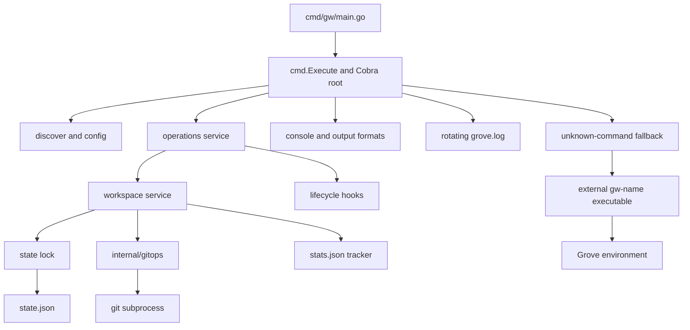

# Architecture

Grove is a local Git worktree workspace orchestrator. The executable entrypoint is intentionally thin: `cmd/gw/main.go` calls `cmd.Execute()`, while Cobra commands translate user intent into calls across the internal packages. Core owns workspace, Git, configuration, persistence, lifecycle, presentation, and diagnostics; integrations such as coding agents, dashboards, archives, and terminal tooling are external plugins rather than in-process subsystems.

## Runtime boundaries

This flow distinguishes Grove-owned control and persistence from the external process boundary. Commands own argument interpretation and presentation; services own policy and orchestration; workspace owns mutations; `gitops` is the only Git subprocess boundary.

## Entry point, commands, discovery, and configuration

`cmd/gw/main.go` does no application work beyond calling `cmd.Execute()`. The root command registers the built-in command set, silences Cobra's default errors and usage so plugin fallback can be attempted, and runs a persistent pre-run for normal commands. Offline commands skip update checks and logging setup; otherwise a terminal-only update notice is offered and structured logging is initialized. The `--no-hooks` flag sets the lifecycle package's global disabled switch, while `--verbose` enables debug logging.

Commands under `cmd/` orchestrate selection, validation, and output. They use the discovery package to find Git repositories in configured directories; discovery can walk repository trees and caches remote URLs on disk. Configuration is loaded from `~/.grove/config.toml`. A missing file means Grove is not initialized, `workspace_dir` defaults to `~/.grove/workspaces`, and the legacy `repos_dir` key is migrated to `repo_dirs`. `config.Save` validates preset names and replaces the file through a temporary file and rename. `models.Config` also carries global hooks and named presets; per-repository `.grove.toml` is read by `gitops.ReadGroveConfig` and supports `base_branch`, setup commands, and repository-local sync or teardown commands.

## Operation and workspace orchestration

`internal/operations` is the user-facing ordering boundary around lifecycle-free workspace primitives. Create provisions through `workspace.Service`, reloads the committed record, then runs `post_create`. Delete loads the record, runs `pre_delete`, passes its recorded `CreatedAt` and `Path` as expected values, and then invokes workspace deletion. Missing hooks are acceptable for create/delete; a hook configured with `on_failure = "abort"` stops the operation, while other hook failures become warnings. A failed aborting `post_create` does not roll back a workspace that was already committed. The `on_close` operation is stricter and reports an absent required hook as an error.

Creation holds the state mutation lock while it creates the workspace directory, validates all selected repositories, fetches sources concurrently, and adds worktrees sequentially. Sequential provisioning preserves reverse-order rollback: failed creation removes created worktrees and only branches created by that operation. State is saved only after all worktrees exist. Repository-local setup commands run after the state commit and lock release, concurrently per repository; setup failures warn rather than roll back. A tracked remote branch can be selected for a repository, with fallback to a new branch from the resolved base when the remote ref is unavailable. Workspace records retain optional opaque source provenance for plugins and display, but core does not interpret provider-specific meaning.

Prune is command-owned batch policy rather than a workspace primitive. `cmd/prune.go` parses `--min-age` with `h`, `d`, or `w` suffixes and treats a bare number as days, loads state, and selects records old enough or whose directory is missing. Invalid ages fail before mutation. Preview mode renders candidates without deleting; `--yes` sends every candidate through `operations.Service.Delete` with force enabled, records each failure on its candidate, renders the complete human or JSON result, and returns joined candidate-named errors afterward. JSON results include name, branch, creation time, age in days, missing-directory status, and an error field when forced deletion fails. This makes partial cleanup visible while preserving a non-zero result.

Deletion is implemented as a guarded, lock-protected cleanup protocol. Without `Force`, it preflights Git registration, branch, current branch, and cleanliness. It verifies expected path and creation time, runs repository-local teardown before taking the mutation lock, reloads and verifies the record inside the lock, and renames an existing workspace root into a sibling `.trash` path. A missing root is treated as stale state, not as permission to skip remaining cleanup: recorded Git worktrees, state, and branches still need reconciliation. Grove prunes each recorded source repository, removes state only after all prune calls succeed, restores the quarantined root and attempts `git worktree repair` if a Git or state phase fails, and deletes non-preserved branches best-effort with warnings. Trash unlink is normally delegated to a detached `unlink-trash` process and falls back to synchronous cleanup when that process cannot start; unlink accepts only paths immediately below `.trash`.

## Git, state, statistics, and models

All Git execution goes through `internal/gitops`. Commands run non-interactively with stdin detached, `GIT_TERMINAL_PROMPT=0`, and batch SSH behavior unless the caller supplied `GIT_SSH_COMMAND`. Combined output is wrapped in `GitError` with command context; verbose traces redact URL credentials and truncate noisy failure output. The wrapper covers repository detection, fetch, branch resolution and creation/deletion, worktree add/remove/list/prune/repair, status, switching, and repository configuration reads. Workspace orchestration therefore does not shell out directly to Git.

`state.Store` owns `~/.grove/state.json`, which is the durable index of named workspaces, paths, branches, repository worktrees, creation timestamps, preservation flags, and optional source metadata. Missing or empty state loads as an empty list; malformed JSON reports a `gw doctor --fix` hint. Saves use a temporary sibling and rename, and `WithLock` serializes read-modify-write operations through the stable `state.lock` file. Path lookup resolves symlinks where possible and is also used to identify the current workspace for plugins. Git remains authoritative for actual worktree registrations and branches; state is Grove's coordination record and can become stale, which is why cleanup and doctor paths explicitly reconcile it.

`workspace.Service` derives its state and statistics stores from `config.GroveDir`. The stats tracker appends `workspace_created` and `workspace_deleted` events to `stats.json` using atomic replacement, tolerates missing or corrupt stats by starting with no events, and renders usage summaries such as a contribution-style heatmap. Creation records a creation event after setup and user-facing success handling; deletion records the corresponding lifecycle event in the removal path. The `models` package defines the serialized workspace, repository worktree, configuration, hook, source-provenance, and stats-event contracts shared across these boundaries.

## Lifecycle hooks, output, and logging

Global hooks are shell commands in `[hooks]`, accepted either as bare strings or metadata tables. `lifecycle.Run` expands shell-quoted `{name}`, `{path}`, `{branch}`, `{source_url}`, `{source_ref}`, and `{source_title}` values. Streamed hooks write line-prefixed output to stderr; quiet hooks capture combined output and reveal it on failure. A positive duration runs the hook in its own process group and kills the group on timeout. The lifecycle package reports whether a failure is aborting; operation policy decides whether that result is fatal or a warning. `--no-hooks` skips them all.

`internal/console` handles terminal-facing tables, color, warnings, and messages. `internal/output` provides stable table-adjacent machine formats: indented JSON, JSON Lines, TSV, and name/path formats, with validation of command-supported formats and compatibility for legacy `--json` flags. Commands therefore keep human output and machine output as explicit presentation choices rather than leaking internal structs indiscriminately. Hook output stays on stderr so commands such as `gw go` can keep stdout usable for shell integration.

Logging is a separate diagnostic channel. `internal/logging` writes timestamped Info, Warn, Error, and optional Debug records to `~/.grove/grove.log`; the file is opened during normal root setup and rotates at 1 MB with three backups. Git calls add verbose timing and sanitized failure traces, while normal command output remains controlled by console and output packages.

## External plugin boundary and fallback

Plugins are external executables named `gw-<name>`, not in-process extensions. When Cobra returns an unknown-command error, `cmd.Execute` extracts the command name, `plugin.Find` validates it, searches `~/.grove/plugins/` before `$PATH`, and dispatches only when an executable is found. Unix execution replaces the current process; Windows starts a child and propagates its exit code. If no executable is found, the original Cobra error is printed. Plugin execution receives `GROVE_DIR`, `GROVE_CONFIG`, `GROVE_STATE`, and, when the current directory lies inside a recorded workspace, `GROVE_WORKSPACE`.

The embedded plugin registry is a separate catalog boundary. It validates and sorts `registry.json` entries for plugin search and resolves a bare install name to an `owner/repo`; it is not an inventory of installed binaries and does not control unknown-command dispatch. `plugin.List` scans executable `gw-*` files in the Grove plugin directory, while `plugin.Find` also discovers PATH installations. An installed plugin can therefore be dispatchable even when absent from the curated registry.

## Focused tests and safe change map

Use real temporary Git repositories for workspace and cleanup behavior. Workspace creation tests cover concurrent fetch, sequential provisioning, branch tracking, rollback, and setup timing; removal tests cover forced and dirty deletion, stale directories, quarantine restoration, preserved branches, expected-record protection, and detached trash cleanup. Operation tests establish hook order, warning versus abort policy, and the invariant that an aborting post-create hook does not undo committed creation. State tests cover atomic persistence, locking, corrupt input, and path lookup; stats tests cover event persistence and heatmap rendering. Command tests cover prune selection and output, discovery, plugin fallback, and machine-readable formats. End-to-end fixtures run the compiled `gw` with isolated homes and Git repositories.

| Boundary | Primary sources | Safe change question |
|---|---|---|
| Entry point and CLI | `cmd/gw/main.go`, `cmd/root.go`, `cmd/*.go` | Is this command parsing, selection, offline setup, output, or plugin fallback policy? |
| Discovery and configuration | `internal/discover/`, `internal/config/config.go`, `internal/models/models.go` | Does this preserve config migration, repository discovery, and per-repo `.grove.toml` semantics? |
| Operation policy | `internal/operations/service.go`, `internal/lifecycle/lifecycle.go` | Does the hook run before or after durable mutation, and can it abort? |
| Workspace mutation | `internal/workspace/create.go`, `internal/workspace/remove.go`, `internal/workspace/service.go` | Are lock, rollback, quarantine, stale-state, and branch invariants preserved? |
| Durable state and usage | `internal/state/`, `internal/stats/`, `internal/models/models.go` | Is the complete record or event stream replaced atomically and safely serialized? |
| Git boundary | `internal/gitops/gitops.go` | Are non-interactive execution, error context, and worktree registration semantics preserved? |
| Presentation and diagnostics | `internal/console/`, `internal/output/output.go`, `internal/logging/logging.go` | Do human output, machine output, stderr behavior, and log redaction remain compatible? |
| External extensions | `internal/plugin/plugin.go`, `internal/plugin/registry.go`, `internal/plugin/registry.json` | Is catalog resolution kept separate from installed-executable discovery and fallback dispatch? |
