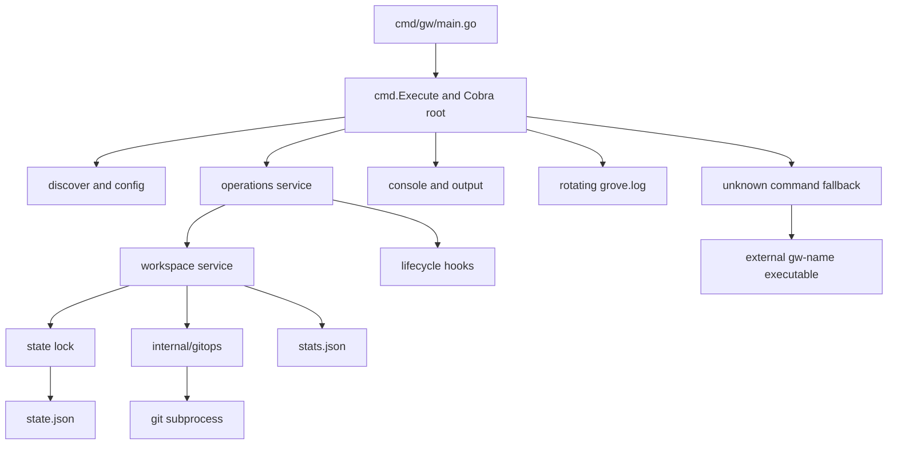
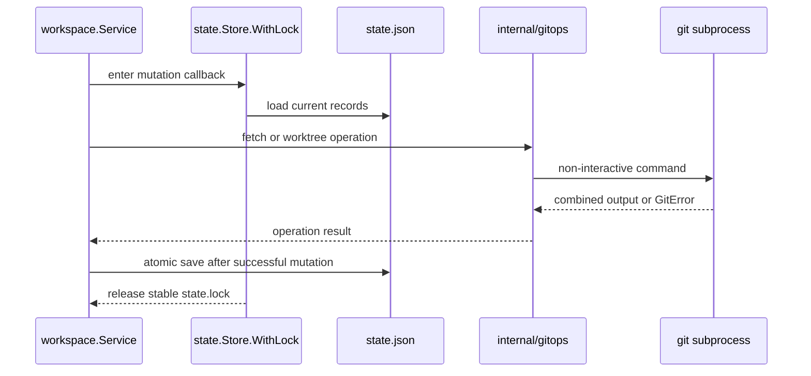

# Architecture

Grove is a local Git worktree workspace orchestrator. The executable entrypoint in `cmd/gw/main.go` is intentionally thin: it calls `cmd.Execute()`. Cobra commands interpret user intent and choose repositories; internal services own policy, mutation, persistence, presentation, and diagnostics. External integrations such as agents, dashboards, archives, and terminal tooling cross the plugin process boundary rather than becoming in-process Grove subsystems.

## Runtime ownership



This boundary is deliberate: commands own argument parsing, interactive selection, and rendering; `internal/operations` owns user-facing ordering and hook policy; `internal/workspace` owns filesystem, worktree, and state mutations; `internal/gitops` is the only Git subprocess boundary; state is Grove's coordination record, not Git's source of truth.

## Entry points, discovery, and configuration

`cmd/root.go` registers built-in commands, silences Cobra's default error and usage output, and runs a persistent pre-run for normal commands. Offline commands skip update checks and logging setup. Other commands offer a terminal-only update notice, initialize logging, and record the command name. `--no-hooks` sets the lifecycle package's disabled switch. `--verbose` enables debug logging, including Git invocation timing and traces.

Create and `add-repo` discover repositories from configured `repo_dirs` using the discovery package, deduplicate by name, and build a name-to-path map. `create` can select a preset, all repositories, explicit names, or an interactive selection; explicit Git URLs are cloned into the first configured repository directory. `add-repo` similarly accepts comma-separated names or URLs, resolves the workspace from its optional name or current directory, and excludes repositories already present from interactive choices.

`config.Load` reads `~/.grove/config.toml`. A missing file means Grove is uninitialized; `workspace_dir` defaults to `~/.grove/workspaces`; and legacy `repos_dir` is migrated to `repo_dirs`. `config.Save` validates preset names and writes through a temporary file and rename. Global hooks and presets live in this config. A source repository may additionally provide `.grove.toml`, whose `base_branch`, setup, sync, and teardown settings are read by `gitops.ReadGroveConfig`; unknown keys remain available to plugins.

## Create and add-repo orchestration

The command layer resolves all inputs before invoking the operation service. In particular, `create` calls `operations.Service.ResolveBranch` before processing destructive `--replace`: a resolver failure or invalid returned branch leaves the current workspace untouched. `ResolveBranch` runs at most once, is skipped for `--track`, validates hook output as a Git branch name, and passes the resolved branch into `Create`. If no resolver is configured, the typed branch is retained.

```mermaid
sequenceDiagram
    participant Create as cmd create
    participant Ops as operations.Service
    participant Life as lifecycle
    participant State as state.Store
    participant Work as workspace.Service
    participant Git as gitops
    Create->>Ops: ResolveBranch request
    Ops->>Life: resolve_branch with name branch source
    Life-->>Ops: one validated branch or error
    Ops-->>Create: resolved request
    Create->>Ops: Delete current workspace when --replace
    Ops->>State: load current record
    Ops->>Life: pre_delete
    Ops->>Work: guarded deletion
    Create->>Ops: Create request
    Ops->>Work: CreateWithOpts
    Work->>State: lock and provision record
    Work->>Git: fetch and add worktrees
    Git-->>Work: worktree results
    Work-->>Ops: committed workspace
    Ops->>State: reload completed record
    Ops->>Life: post_create
```

The sequence shows the important ownership rule: `resolve_branch` precedes `--replace` deletion, `post_create` follows successful durable creation, and a failing aborting `post_create` does not roll back an already committed workspace. `workspace.CreateWithOpts` holds the state mutation lock while creating the directory, validating every selected repository, fetching sources concurrently, and adding worktrees sequentially. Sequential provisioning enables reverse-order rollback of worktrees and only branches created by this operation. State is saved after all worktrees exist. Per-repository setup commands run concurrently after commit and lock release; setup failures warn instead of rolling back.

`add-repo` calls the workspace primitive under the state lock, which skips already-present repositories, provisions new worktrees sequentially on the workspace branch, rolls back partial additions on failure, and updates state only after successful additions. `post_add_repo` is then run only when the primitive reports that at least one repository was actually added; it is not run for an all-already-present request or a failed mutation.

## Git and persistence boundaries

All Git execution goes through `internal/gitops`. Its runner detaches stdin, sets `GIT_TERMINAL_PROMPT=0`, uses batch SSH behavior unless the caller supplies `GIT_SSH_COMMAND`, captures combined output, and wraps failures in `GitError`. It covers repository detection, fetch, base and branch resolution, branch creation and deletion, worktree add/remove/list/prune/repair, status, switching, and repository configuration. Workspace code never shells out directly to Git.



`state.Store` owns `~/.grove/state.json`, recording workspace names, paths, branches, timestamps, repository worktrees, preservation flags, and optional opaque source provenance. Missing or empty state loads as an empty list; malformed JSON reports a `gw doctor --fix` hint. Saves use a temporary sibling and rename. `WithLock` uses the stable `state.lock` file to serialize cross-process read-modify-write operations. Git remains authoritative for actual worktree registrations and branches, so cleanup and doctor operations must reconcile stale state with Git.

Workspace creation and addition use the lock for mutation, but run setup commands after releasing it because those commands may invoke `gw`. The stats tracker separately appends `workspace_created` and `workspace_deleted` events to `stats.json` with atomic replacement and tolerates missing or corrupt stats by starting empty. `models.WorkspaceSource` is stored and displayed as opaque provenance; core does not interpret provider-specific meaning.

## Lifecycle policy, deletion, and failures

`internal/operations` is the lifecycle-aware ordering boundary around lifecycle-free workspace primitives. Create reloads the committed record before `post_create`; delete loads the record, runs `pre_delete`, supplies its recorded path and creation time as expected values, and only then invokes workspace deletion. Missing create/delete hooks are acceptable. A hook with `on_failure = "abort"` stops the operation; other failures become warnings. `on_close` is stricter and reports a missing required hook as an error.

`lifecycle.Run` loads global hooks, shell-quotes `{name}`, `{path}`, `{branch}`, `{source_url}`, `{source_ref}`, and `{source_title}`, and either streams line-prefixed output to stderr or captures quiet output until failure. Positive timeouts run hooks in their own process group so descendants can be killed. `Resolve` requires exactly one non-empty stdout line and treats command, timeout, and malformed-output failures as aborting value errors. `--no-hooks` skips all hooks.

Deletion is a guarded, lock-protected cleanup protocol. Without force it preflights Git registration, branch, current branch, and cleanliness; verifies the expected path and creation time; runs repository teardown before the mutation lock; then quarantines the workspace root into a sibling `.trash` path. It reconciles recorded worktrees, state, and branches, restores the quarantine and attempts `git worktree repair` if a Git or state phase fails, and removes non-preserved branches best-effort with warnings. Missing roots are stale state, not permission to skip reconciliation. Trash cleanup normally uses a detached `unlink-trash` process and falls back to synchronous cleanup.

## Output, logging, and operational diagnostics

`internal/console` owns terminal-facing messages, tables, colors, prompts, and warnings. `internal/output` provides validated stable machine formats including indented JSON, JSON Lines, TSV, and name/path output, with compatibility for legacy `--json` flags. Hook output stays on stderr, preserving stdout for shell integrations such as `gw go`.

Logging is a separate diagnostic channel: normal Info, Warn, and Error records remain in the rotating `~/.grove/grove.log` even without `--verbose`. The file rotates at 1 MB and keeps three backups. `--verbose` additionally enables Debug records and Git invocation tracing with elapsed time and sanitized failure output. Git traces redact credentials embedded in URLs before truncating noisy output to 2048 bytes, so credentials do not leak and a chatty failure cannot evict the rest of the rotating log.

## External plugins

Plugins are external executables named `gw-<name>`, not in-process extensions. When Cobra returns an unknown-command error, `cmd.Execute` extracts the name, `plugin.Find` validates it, searches `~/.grove/plugins/` before `$PATH`, and dispatches only if an executable is found. Unix execution replaces the process; Windows starts a child and propagates its exit code. The plugin receives `GROVE_DIR`, `GROVE_CONFIG`, `GROVE_STATE`, and, when the current directory is inside a recorded workspace, `GROVE_WORKSPACE`.

The embedded registry is a catalog for plugin search and owner/repository resolution, not an inventory of installed binaries and not the unknown-command dispatcher. `plugin.List` scans executable `gw-*` files in the Grove plugin directory, while `plugin.Find` also discovers PATH installations. Thus an installed PATH plugin can be dispatchable even when absent from the curated registry.

## Focused tests and safe change map

The most valuable tests use real temporary Git repositories and isolated homes. Operation tests assert resolver-before-create ordering, resolver-once behavior, hook order, warning versus abort policy, and the invariant that an aborting `post_create` does not undo committed creation. End-to-end tests assert that a resolver failure creates nothing and that `--replace` preserves the old workspace when resolution fails. Workspace tests cover concurrent fetch, sequential provisioning, tracking fallback, reverse rollback, setup timing, add-repo behavior, stale directories, quarantine restoration, preserved branches, and expected-record protection. State tests cover atomic persistence, locking, corrupt input, and path lookup; Git trace tests cover redaction and truncation; logging tests cover rotation; command tests cover discovery, plugin fallback, prune selection, and machine-readable formats.

| Boundary | Primary sources | Safe change question |
|---|---|---|
| Entry point and CLI | `cmd/gw/main.go`, `cmd/root.go`, `cmd/create.go`, `cmd/addrepo.go` | Is this parsing, selection, offline setup, output, or plugin fallback policy? |
| Discovery and configuration | `internal/discover/`, `internal/config/config.go`, `internal/models/models.go` | Does this preserve config migration, repository discovery, presets, and per-repo `.grove.toml` semantics? |
| Operation policy | `internal/operations/service.go`, `internal/lifecycle/lifecycle.go` | Does this preserve resolver-before-replace, post-mutation hook order, and abort versus warning behavior? |
| Workspace mutation | `internal/workspace/create.go`, `internal/workspace/repos.go`, `internal/workspace/remove.go`, `internal/state/lock.go` | Are lock, rollback, quarantine, stale-state, and branch invariants preserved? |
| Durable state and usage | `internal/state/`, `internal/stats/`, `internal/models/models.go` | Are records and event data serialized atomically and reconciled with Git? |
| Git boundary | `internal/gitops/gitops.go` | Are non-interactive execution, error context, tracing redaction, and worktree semantics preserved? |
| Presentation and diagnostics | `internal/console/`, `internal/output/output.go`, `internal/logging/logging.go` | Do human output, machine output, stderr behavior, normal logs, and verbose traces remain compatible? |
| External extensions | `internal/plugin/plugin.go`, `internal/plugin/registry.go` | Is catalog resolution kept separate from installed-executable discovery and fallback dispatch? |
