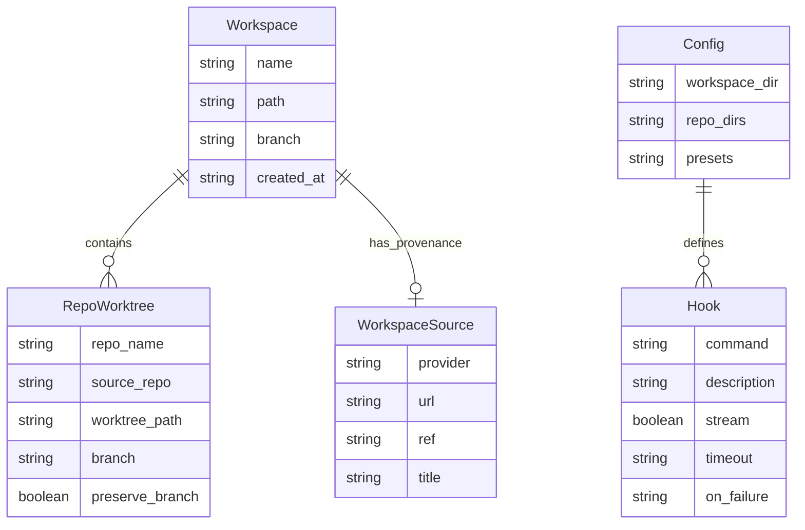
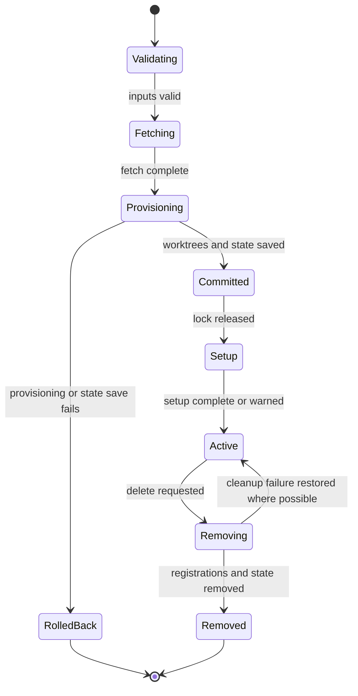

# Concepts and Data Model

Grove coordinates independent Git repositories. A **workspace** is a named durable record containing one worktree entry per selected source repository; it is not one shared Git branch. Git remains authoritative for live worktree registration and checkout state, while `state.json` records intended membership, paths, branches, and ownership-related metadata used for safe mutation.

## Entity relationships

*The persisted workspace model and the separate global configuration and hook model; `source_repo` is a filesystem path to the Git repository selected during discovery.*

### Workspace and worktree records

`Workspace` has a unique operational `Name`, root `Path`, workspace-level `Branch`, local `CreatedAt` timestamp, ordered `Repos`, and optional `Source`. `RepoWorktree` records `RepoName`, the source repository path, expected worktree path, branch, and `PreserveBranch`. `FindRepo`, `RemoveRepo`, and `RepoNames` identify entries by `RepoName`; duplicate names are not a second identity.

The workspace branch is a requested convention applied independently in each source repository. Provisioning refuses a branch that already has another worktree in that source repository. If the local branch already exists, Grove reuses it and does not claim that Grove created it. If provisioning creates a branch, the current attempt records that fact internally, allowing rollback to delete only branches created by that attempt. `PreserveBranch` affects later branch deletion; it does not preserve a worktree registration or its directory.

A recorded `RepoWorktree.Branch` is intent, not proof of the live checkout. Status reads the current branch from Git and reports `(detached)` when there is none. Manual branch switches and detached worktrees are drift and do not silently rewrite state.

## Repository discovery and deduplication

Discovery starts with configured `repo_dirs` and scans down up to three levels, stopping descent at a Git repository. A discovered repository has a folder name, absolute path, remote, and a display name derived as `owner/repo` when the remote is parseable. Remote URLs are resolved from `origin`; the remote cache lasts 24 hours and is invalidated by `.git/config` mtime. Cache misses are fetched in parallel with a limit of 16, and cache persistence is best effort.

The discovery name is the workspace-local selection key. `RepoMap` and `UniqueByName` retain the first repository for a name, making folder-name collisions deterministic rather than creating a second identity. Repositories with the same remote identity are deduplicated: canonical remote identity normalizes the host, removes a trailing `.git`, and treats URL and scp-like forms equivalently. Repositories without a remote are deduplicated by resolved local path. Where duplicate paths share a remote, a direct child of the configured root wins over a nested copy; final results are sorted by display name and then path.

## Branch modes and resolution

Creation has two modes:

- **Create mode** (the default) reuses an existing local branch or creates the requested branch from the resolved base.
- **Track mode** is for an existing remote branch, such as a pull-request head. After fetch, if `origin/<branch>` exists, `git worktree add --track -b <branch>` creates a local tracking branch. If it does not exist, Grove warns and falls back to create mode. `TrackBranchRepo` can restrict tracking to one repository, so sibling repositories create fresh branches from base instead of accidentally tracking the same name.

The typed branch and the resolved branch are distinct concepts. The optional `resolve_branch` value hook receives the typed branch plus workspace name and source metadata, must return exactly one non-empty line, and its output must pass Git branch-name validation. If no resolver is configured, the typed branch is retained. Track mode skips resolution because the supplied name is the real branch name. Resolution happens once per creation operation: `ResolveBranch` marks the request resolved, `Create` does not resolve it again, and the resolved value is persisted and reused by later add-repo operations. Callers can resolve before destructive replacement so a resolver failure leaves the existing workspace untouched.

For create mode, each source repository resolves its base independently. Per-repository `.grove.toml` `base_branch` takes precedence; otherwise the detected default branch is used as `origin/<branch>`. Branch creation retries with the unqualified branch and finally `HEAD` if the remote-qualified base cannot be used. Sync and status use the same resolver, although status retains an `origin/main` fallback when resolution fails.

## Creation, commit boundary, and rollback

Creation validates the name and rejects an existing workspace identity, creates `<workspace_dir>/<name>`, validates all selected repository names, fetches repositories in parallel, then adds worktrees sequentially. Sequential provisioning is deliberate: it makes rollback order explicit. State is added only after every worktree succeeds.

A missing repository, failed worktree, or failed state commit rolls back worktrees in reverse order, deletes only branches created in this invocation, and removes the empty workspace root when possible. A committed workspace is not rolled back because a setup command fails. Setup commands come from each source repository's `.grove.toml`, run after the state commit and after releasing the cross-process state lock; they may invoke Grove recursively and therefore run as warnings rather than transactional workspace changes. Adding repositories follows the same lock, provision, update-state, and rollback pattern.

*Creation has a transactional provisioning boundary; setup and deletion have separate post-commit and restore semantics.*

Deletion runs per-repository teardown commands before the mutation lock, then reloads and rechecks the record under the lock. An existing workspace root is quarantined by renaming it beneath `.trash`; Git worktree registrations are pruned and state is removed. If pruning or state removal fails, Grove restores quarantined bytes where possible and keeps state as evidence of incomplete cleanup. After successful cleanup, branch deletion is best effort and skips `PreserveBranch`; a branch-delete warning does not undo completed worktree and state removal. Trash unlinking is scheduled outside the lock and restricted to a `.trash` child.

A missing workspace directory is a stale record, not proof that deletion completed: registrations, state, and eligible branches still require cleanup. Safe non-forced removal refuses missing registrations, recorded/live branch mismatch, detached state, or dirty worktrees. `--force` bypasses these preflight checks but does not rewrite recorded intent.

## Provenance and extension boundaries

`WorkspaceSource` contains `Provider`, `URL`, optional `Ref`, and optional `Title`. These fields are opaque to core: Grove persists and displays them but does not interpret GitHub, GitLab, Notion, Slack, or other external references. Integrations and plugins resolve an external item and pass repository and branch choices into creation. Provenance never substitutes for the recorded source repository, worktree path, or branch, so changing a source placeholder cannot change workspace identity.

The source is copied into lifecycle context after creation. Global hooks can use shell-quoted `{name}`, `{path}`, `{branch}`, `{source_url}`, `{source_ref}`, and `{source_title}` placeholders. Empty source values expand to nothing. Thus a plugin can pass an opaque placeholder through creation, state, status, and hooks without core deriving meaning from it or assigning a new workspace identity. Status table and JSON output expose the same source metadata.

Global hooks live in `[hooks]` in `~/.grove/config.toml`. A hook may be a legacy bare command string or a metadata table with `description`, `stream`, Go-duration `timeout`, and `on_failure = "warn"` or `"abort"`. Bare hooks remain bare when written. Captured output is shown, prefixed, only on failure; streamed output goes to stderr so stdout stays safe for commands such as `cd "$(gw go ...)"`. Valid timeouts kill the hook's process group; invalid timeouts are warned about and ignored. Ordinary hook failures carry policy metadata and callers decide whether `abort` is fatal. `Resolve` is stricter: it requires exactly one non-empty stdout line and always treats failure or malformed output as aborting. `--no-hooks` disables hooks. Workspace setup and teardown commands are separate repository-owned commands, not global hook metadata.

## Configuration and durable state

Global `~/.grove/config.toml` owns repository roots, workspace directory, named presets, and global hooks. `repo_dirs` is current; loading legacy `repos_dir` with no `repo_dirs` migrates it to a one-element list and atomically saves the migration. An empty workspace directory defaults to `~/.grove/workspaces`. `Init` resolves and validates supplied directories, deduplicates them, creates Grove and workspace directories, and saves configuration atomically. Presets are only named repository-name lists; they do not own branches, worktrees, or repository settings. Per-repository `.grove.toml` owns `base_branch`, setup, `pre_sync`, `post_sync`, and teardown. Unknown per-repository keys are ignored for plugin extension, and that file is cached for the process.

`state.json` is a JSON array of workspaces. Missing or whitespace-only state loads as an empty collection; malformed JSON is an actionable corrupt-state error. Saves create the parent directory, write a temporary file, and rename it atomically. Model decoding remains tolerant of older records that omit `repos`, `created_at`, or `source`; a nil source is omitted when marshalled and new source fields round-trip without rewriting old records.

State operations look up by workspace name. Path lookup evaluates symlinks and matches either the exact workspace root or a contained path. Rename replaces the existing entry, changes its name and root, and rewrites recorded worktree paths from the old root to the new root; it is a rename of the same identity, not a new workspace. Mutating services wrap read-modify-write operations in `state.lock`, an OS advisory exclusive lock held while the callback runs. The lock is separate from `state.json`, whose atomic replacement therefore cannot invalidate the lock inode or permit lost concurrent updates.

`stats.json` is separate disposable observational history. Successful create and delete flows append events; stats corruption resets history rather than blocking workspace state, and recording statistics never repairs Git drift or redefines identity.

## Focused tests

- `internal/models/models_test.go` protects construction, repository-name operations, tolerant JSON round trips, opaque source persistence and omission, and issue encoding.
- `internal/state/state_test.go` protects missing and empty loads, corrupt-state behavior, atomic saves, rename path rewriting, symlink-aware lookup, and cross-process locking.
- `internal/workspace/create_test.go` protects duplicate names, branch conflicts, create/track behavior, tracking ownership, source persistence, rollback, and concurrent state preservation.
- `internal/workspace/remove_test.go` protects safe preflight checks, quarantine and restore behavior, and stale-directory cleanup that still prunes Git registrations and state.
- `internal/gitops/gitops_test.go` protects base-branch resolution, remote identity behavior, `.grove.toml` parsing, and configuration caching.
- `internal/lifecycle/lifecycle_test.go` protects placeholder expansion, streaming and captured output, timeout behavior, and resolver output contracts.
- `internal/operations/service_test.go` protects typed-versus-resolved branches, exactly-once resolution, track-mode resolver bypass, source-to-hook variables, and post-create policy.
- `internal/workspace/status_test.go` and `internal/workspace/sync_test.go` protect provenance rendering, live-versus-recorded branch reporting, and sync safety.
