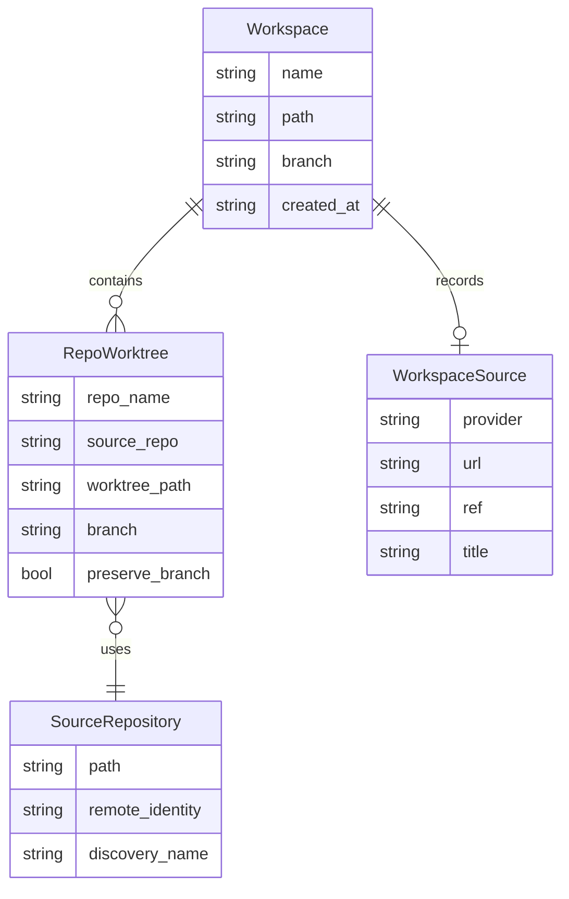
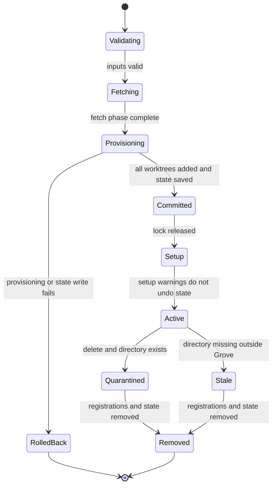

# Domain Concepts

Grove coordinates independent Git repositories. A workspace is not one shared Git branch: it is a named record containing one worktree entry per selected source repository. Git remains authoritative for registrations and live checkout state; Grove state records intended membership, paths, branches, and ownership information needed for safe mutation.

## Repository discovery and identity

Discovery starts from configured `repo_dirs` and deep-scans up to three levels, stopping descent when it finds a Git repository. Each result has a folder `Name`, absolute `Path`, `Remote`, and a display name derived as `owner/repo` when the remote is parseable. Remote URLs are resolved from `origin`, with a 24-hour cache invalidated by `.git/config` mtime; cache misses are fetched in parallel, capped at 16 concurrent fetches, and cache persistence is best effort.

A repository's discovery name is the workspace-local selection key. `RepoMap` and `UniqueByName` keep the first repository for a name, so folder-name collisions are deterministic rather than a second identity. Discovery deduplicates repositories with the same remote identity. For remote-bearing repositories, canonical identity normalizes the host, strips a trailing `.git`, and treats URL and scp-like network forms alike; repositories without a remote are deduplicated by resolved local path. When duplicate paths share a remote, a direct child of the configured root wins over a nested copy, and final results are sorted by display name then path.

*The conceptual relationships between discovery identity, source repositories, per-repository worktrees, and optional provenance.*

## Workspaces, worktrees, and branches

`Workspace` contains a unique operational `Name`, root `Path`, workspace-level `Branch` string, local `CreatedAt` timestamp, ordered `Repos`, and optional `Source`. A `RepoWorktree` stores the discovery name, source repository path, expected worktree path, branch, and `PreserveBranch`. `FindRepo`, `RemoveRepo`, and `RepoNames` use `RepoName`; duplicate names are not a supported second identity.

The workspace branch is a convention applied independently in every source repository. Creation rejects a branch already attached to another worktree in that source repository. An existing local branch is reused rather than recreated, and its record is not automatically marked as Grove-owned. A branch created during the current provisioning attempt is tracked internally so rollback can delete only that branch. `PreserveBranch` controls branch deletion during later cleanup; it does not retain the worktree or its registration.

Creation supports two branch modes:

- **Create mode**, the default, reuses an existing local branch or creates the requested branch from the resolved base.
- **Track mode**, intended for an existing remote branch such as a pull-request head, creates a local tracking worktree when the remote branch exists. If it does not exist, it warns and falls back to create mode. A resolver can restrict tracking to one repository; sibling repositories then create branches from base instead of accidentally tracking the same name.

Base resolution is per source repository: `.grove.toml` `base_branch` wins, otherwise the detected default branch is used as `origin/<branch>`. Branch creation retries with a plain branch name and finally `HEAD` if the resolved remote-qualified base cannot be used. Sync and status use the same base resolver, with status retaining an `origin/main` fallback when resolution fails.

`RepoWorktree.Branch` is recorded intent, not a live checkout claim. Status reads the current branch from the worktree and displays `(detached)` when Git reports none, while retaining the recorded branch in state. A manually switched or detached worktree is drift, not an implicit state update.

## Creation, mutation, and deletion safety

Creation validates the workspace name before provisioning and rejects an existing workspace identity. It creates `<workspace_dir>/<name>/`, fetches selected source repositories in parallel, then adds worktrees sequentially so partial work can be rolled back. Complete state is written only after all worktrees succeed. A missing repository, failed worktree, or failed state commit rolls back worktrees and only branches created by that invocation; an empty root created by the attempt is removed. Setup commands run after the state commit and after releasing the cross-process mutation lock, because user commands may invoke Grove themselves. Setup failures warn and do not undo the committed workspace.

*Workspace lifecycle phases describe observable safety boundaries; `Quarantined`, `Stale`, and `RolledBack` are conditions rather than persisted enum values.*

Normal deletion runs per-repository teardown commands before the mutation lock, reloads and rechecks the record under the lock, and quarantines an existing workspace root by renaming it beneath `.trash`. It then prunes every recorded source-repository worktree registration and removes the state entry. If pruning or state removal fails, quarantined bytes are restored where possible and state remains evidence of incomplete cleanup. After successful cleanup, branch deletion is best effort and skips records with `PreserveBranch`; a branch-delete warning does not undo completed worktree and state removal. Trash unlinking is scheduled outside the lock and is constrained to a `.trash` child path.

A missing workspace directory is a stale record, not proof that cleanup finished. There are no bytes to quarantine, but Git registrations, state, and eligible branches are still cleaned in the same order. This prevents external deletion of workspace files from leaving source repositories or durable metadata behind.

Safe non-forced removal validates each recorded worktree path is still registered in its source repository, that the registered branch and live current branch equal the recorded branch, and that the worktree is clean. It refuses missing registrations, branch drift, detached state, or dirty worktrees. `--force` bypasses these preflight checks; it does not rewrite recorded intent. Teardown is separate from global hooks and is best effort through the workspace service.

## Time, pruning, and compatibility

`NewWorkspace` writes `created_at` as a local wall-clock timestamp with six fractional digits (`2006-01-02T15:04:05.000000`). Prune readers also accept the older second-precision form. Invalid or missing timestamps are not age candidates while the workspace directory exists.

`gw prune --min-age` accepts hours (`h`), days (`d`), weeks (`w`, seven days), and a bare non-negative number retaining the original day meaning. Empty, negative, malformed, and unsupported-unit values are rejected. A record is age-eligible when its parsed creation time is at least the requested duration before now. A missing workspace directory is eligible independently of age, including when its timestamp is invalid. Candidate output preserves state order and marks missing records with `missing: true`; preview does not mutate. With `--yes`, pruning attempts every candidate through forced deletion, continues after failures, and reports an error on only the candidates whose deletion attempt failed.

## Persisted state and config ownership

`state.json` is a JSON array of workspaces. A missing or whitespace-only file loads as an empty collection; malformed JSON is an actionable corrupt-state error. Saves create the parent directory, write a temporary file, and atomically rename it. Store operations look up by name, and path lookup resolves symlinks before matching an exact workspace root or a contained path. Rename replaces the existing state entry, changes its name and root, and rewrites each recorded worktree path from the old root to the new root; it is not a new workspace identity. Mutating services use the state lock around read-modify-write commits to prevent lost concurrent updates.

Model JSON unmarshalling is intentionally tolerant for compatibility: old records may omit `repos`, `created_at`, or `source`, and nil `Source` is omitted when marshalled. New source fields round-trip without changing old records. State remains authoritative for intended membership, but not live Git drift; status and doctor should expose broken relationships rather than silently repair them.

Global `~/.grove/config.toml` owns repository roots, workspace directory, named presets, and global hooks. `repo_dirs` is the current key. Loading a legacy `repos_dir` with no `repo_dirs` migrates it to a one-element `repo_dirs` list and saves the migrated configuration; a missing workspace directory defaults to `~/.grove/workspaces`. Config saves validate preset names (`[a-zA-Z0-9_-]+`) and use a temporary file plus rename. Initialization resolves and validates supplied directories, deduplicates them, creates Grove and workspace directories, and saves atomically.

A `Preset` is only a named list of repository names for selection. It does not own branches, worktrees, or repository settings. Per-repository `.grove.toml` owns `base_branch`, setup commands, `pre_sync`, `post_sync`, and teardown. Unknown per-repository keys are ignored so plugins can extend that file. `.grove.toml` is cached for the process, so a command does not observe edits made after its first read.

## Provenance and hooks

`WorkspaceSource` contains opaque `Provider`, `URL`, optional `Ref`, and optional `Title` fields. Core persists and displays them, including in status table and JSON output, but does not resolve GitHub, GitLab, Notion, Slack, or other external references. Integrations and plugins resolve an external source and pass repository and branch choices into creation. Provenance is metadata: it cannot replace the recorded source repository, worktree path, or branch.

Global hooks in `[hooks]` accept either the legacy bare command string or a metadata table. Metadata can provide `description`, live `stream` output, a Go duration `timeout`, and `on_failure = "warn"` or `"abort"`. Bare hooks are written back as bare strings, preserving a minimal compatible config format. Commands expand shell-quoted `{name}`, `{path}`, `{branch}`, `{source_url}`, `{source_ref}`, and `{source_title}` placeholders. By default output is captured and shown, prefixed, only on failure; streamed output goes to stderr so stdout remains safe for commands such as `cd "$(gw go ...)"`. Invalid timeouts are warned about and ignored; valid timeouts kill the hook process group. Hook failures are represented with policy metadata, and callers decide whether `abort` is fatal. `--no-hooks` disables global hooks.

Repository setup and teardown commands are separate from global hook metadata: setup is read from each source repository and runs after creation, while teardown runs before deletion cleanup. Sync skips dirty worktrees, runs `pre_sync`, rebases onto the resolved base, aborts a failed rebase, then runs `post_sync`; failures in these repository commands are warnings rather than state rewrites.

## Output and lifecycle statistics

The output package defines stable representations: table, indented JSON, compact JSON Lines, TSV, repository/workspace `name`, and `path`. `--json` is a compatibility alias for `--output json`; combining it with a different explicit output is rejected. Commands declare supported formats, and JSON/JSONL/TSV are designed for scripts while human tables may include status and provenance presentation. Status JSON includes workspace name, path, optional source, and per-repository live branch/status/ahead/behind data; JSONL emits one repository status per line.

`stats.json` is separate observational history, not workspace state. Successful create and delete flows append `StatsEvent` records containing event kind, timestamp, workspace name, branch, repository names, and count. Stats timestamps accept both current six-digit and older second-precision forms for aggregation. Missing or empty stats load as no history; corrupt stats are silently reset as disposable history, unlike corrupt `state.json`. Stats recording after a state commit must not redefine workspace identity or repair Git drift. Reports derive created/deleted counts, active count, repository usage, lifetime, and a date heatmap from the event stream.

## Focused tests that protect the model

- `internal/models/models_test.go` protects workspace construction, repository-name operations, JSON round trips, opaque source persistence and omission, backward-compatible records, and doctor issue encoding.
- `internal/state/state_test.go` protects empty/missing loads, corrupt-state behavior, atomic JSON saves, rename path rewriting, symlink-aware path lookup, and cross-process locking against lost updates.
- `internal/workspace/create_test.go` protects duplicate names, branch conflicts, create/track fallback, tracking ownership and rollback, source persistence, and concurrent state preservation.
- `internal/workspace/remove_test.go` protects safe preflight checks, quarantine/restore behavior, and stale-directory cleanup that still prunes Git registrations and state.
- `internal/gitops/gitops_test.go` protects base-branch resolution, `.grove.toml` parsing, remote identity behavior, and configuration caching.
- `cmd/prune_test.go` protects duration parsing, legacy bare-number semantics, missing-directory candidates, timestamp compatibility, JSON output, and continue-on-error deletion.
- `internal/workspace/status_test.go`, `internal/workspace/sync_test.go`, and lifecycle tests protect provenance rendering, live-versus-recorded branch reporting, hook ordering, and sync safety.
