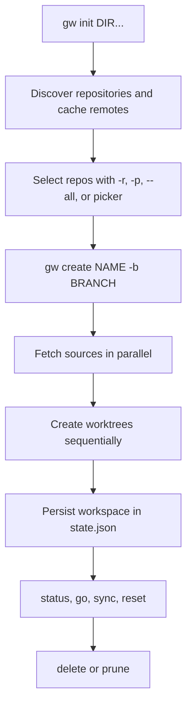

# Quickstart

Grove (`gw`) coordinates one Git worktree per selected repository inside a named workspace. The workspace has one feature-branch identity, while each repository may use its configured base branch. Grove requires `git` on `PATH`.

## 1. Install and enable navigation

Choose one installation method:

```bash
brew install nicksenap/grove/grove
curl -fsSL https://raw.githubusercontent.com/nicksenap/grove/master/scripts/install.sh | sh
go install github.com/nicksenap/grove/cmd/gw@latest
```

The install script verifies the release checksum and installs to `/usr/local/bin`, or `~/.local/bin` when that is not writable; `GW_INSTALL_DIR` and `GW_VERSION` override those choices. To let `gw go` and `gw create` change the parent shell directory, add the wrapper to Bash or Zsh:

```bash
eval "$(gw shell-init)"
```

For Nushell, generate `~/.config/nushell/grove.nu` and source it from `config.nu`:

```bash
gw shell-init --shell nu | save -f ~/.config/nushell/grove.nu
```

Without shell integration, Grove can print a destination but cannot change the parent shell's directory.

## 2. Initialize repository discovery

Register existing directories that contain Git repositories:

```bash
gw init ~/dev ~/work/microservices
```

`gw init [DIR...]` resolves each directory to an absolute path, rejects missing directories, merges and deduplicates the roots in `~/.grove/config.toml`, creates the Grove and workspace directories, saves configuration, and scans the roots. Remote URLs are cached in `~/.grove/cache/remotes.json`. The default workspace root is `~/.grove/workspaces`; `workspace_dir` and repository roots are configurable. Commands that need configuration stop with a prompt to run `gw init`.

Keep initialization explicit and use real parent directories. Configuration, cache, hooks, diagnostics, and recovery belong in [Operations](operations.md).

## 3. Create the first workspace

The shortest deterministic example names both the branch and repositories:

```bash
gw create feat-login -b feat/login -r svc-a,svc-b
```

Other useful selection forms are:

```bash
gw create -b feat/login -p backend
gw create -b feat/login --all
```

`NAME` is optional: when omitted, Grove derives it from the branch by replacing `/` and spaces with `-`. In a terminal, omitted repository selection opens a picker (presets first), and omitted `-b` prompts for a branch; scripts should provide both. A Git URL in `-r` can be cloned into the first configured repository directory when it is not already discovered.

Use `--track` when the selected repositories should check out an existing remote branch (for example, a PR head); if it is unavailable, Grove falls back to creating a branch. `--source-url`, `--source-provider`, `--source-ref`, and `--source-title` record opaque provenance on the workspace for integrations; Grove stores and displays that metadata but does not interpret it.

Creation fetches selected sources concurrently and creates worktrees sequentially. It persists `~/.grove/state.json` only after all worktrees exist. A provisioning failure rolls back worktrees, branches created by that attempt, and the workspace directory. Per-repository setup from `.grove.toml` runs after the state commit, so a setup failure does not roll back the workspace.



*This flow shows discovery, provisioning, persistence, daily use, and cleanup.*

For branch resolution, hooks, setup commands, and rollback details, see [Workflows](workflows.md) and [Domain Concepts](concepts.md).

## 4. Navigate, inspect, and synchronize

```bash
gw list                         # list workspaces
gw ws show feat-login            # inspect one workspace
gw go feat-login                 # print or cd to its path
gw status feat-login             # show repository status
gw sync feat-login               # rebase repos onto their base branches
gw reset feat-login              # restore workspace branches, then sync
```

`status`, `sync`, and `reset` accept an optional name and auto-detect the workspace from the current directory when omitted. `gw go` prints the path to stdout; the shell wrapper consumes it to change directory. `gw go --back` returns to a source-repository directory. `reset` skips dirty repositories on another branch unless `--discard` is supplied.

For a detailed view, use `gw status --verbose`; for diagnostics across commands, use the global `gw --verbose ...` debug-logging flag. List-style queries support `--output` (`-o`) with `table`, `json`, `jsonl`, `tsv`, `name`, and `path`; `--json` / `-j` remains a compatibility alias for JSON. Query data goes to stdout while progress, prompts, warnings, and errors go to stderr:

```bash
gw list -o name | fzf
gw status feat-login -o jsonl | jq -r 'select(.changed > 0) | .repo'
```

To add a repository later, use `gw add-repo feat-login`; the `post_add_repo` lifecycle policy runs only when at least one repository was actually added. `gw remove-repo` removes one from an existing workspace. To change the workspace branch identity safely, configure `resolve_branch`: it runs before destructive `--replace` work, and the resolved branch is stored and reused when adding repositories. The global `--no-hooks` (or `-n`) disables lifecycle hooks, so use it only deliberately. See [Integrations](integrations.md) for hooks, shells, Git, and source-provider seams.

## 5. Clean up safely

Deletion removes worktrees, branches, workspace files, and state. Review targets first; keep hooks enabled unless bypassing policy is intentional:

```bash
gw delete feat-login
gw prune                         # preview; default minimum age is 7d
gw prune --min-age 12h
gw prune --yes --min-age 7d       # attempt every candidate
gw doctor
gw doctor --fix
```

`gw prune` previews by default. `--min-age` accepts `h`, `d`, or `w`; a bare number means days, and invalid or negative values are rejected. Candidates include workspaces at least that old and workspaces whose directory is missing, regardless of age. With `--yes`, every candidate is attempted; failures are reported per workspace and produce a non-zero exit. Existing directories are quarantined under sibling `.trash` before cleanup so Git or state failures can restore them. A missing directory skips quarantine but still removes Git worktree registrations and the state record, then attempts branch cleanup. Run `gw doctor` before manually repairing state or quarantine data. See [Operations](operations.md) for recovery and [Workflows](workflows.md) for deletion sequencing.

## Task-routing map

- **Create, add, navigate, inspect, sync, reset, rename, replace, delete, prune, or use machine-readable output:** [Workflows](workflows.md)
- **Understand repositories, workspaces, worktrees, branches, sources, presets, hooks, configuration, and persisted-state invariants:** [Domain Concepts](concepts.md)
- **Change Cobra command wiring, orchestration, state, Git, output, or plugin boundaries:** [Architecture](architecture.md)
- **Install, configure, use `resolve_branch` or `post_add_repo`, diagnose, recover cleanup, manage `--no-hooks`, or operate logs:** [Operations](operations.md)
- **Integrate lifecycle hooks, shell navigation, Git, source metadata/providers, editors, or external automation:** [Integrations](integrations.md)
- **Validate command behavior, lifecycle ordering, state/Git invariants, or end-to-end flows:** [Testing](testing.md)

## Focused validation

Contributors can run:

```bash
just build
just test
go test ./internal/workspace -run TestName -v
just e2e
just check
```

`just check` is the CI-quality gate. Workspace and end-to-end tests are the useful starting points when changing provisioning, state, filesystem, Git worktree registration, or branch cleanup; lifecycle tests matter when changing hooks such as `resolve_branch` or `post_add_repo`. See [Testing](testing.md) for the validation matrix.
