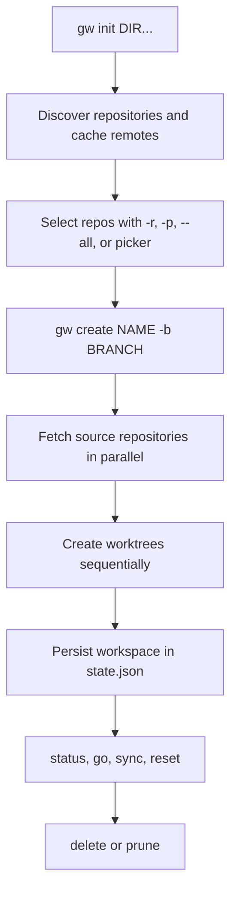

# Quickstart

Grove (`gw`) is a Go CLI that coordinates one Git worktree per selected repository inside a named workspace. A workspace gives the repositories one feature branch name, while each repository can resolve its own configured base branch.

## 1. Install and enable shell integration

Grove is a single binary and requires `git` on `PATH`. Choose one installation method:

```bash
brew install nicksenap/grove/grove
curl -fsSL https://raw.githubusercontent.com/nicksenap/grove/master/scripts/install.sh | sh
go install github.com/nicksenap/grove/cmd/gw@latest
```

The install script verifies its checksum and installs to `/usr/local/bin`, or `~/.local/bin` when needed; `GW_INSTALL_DIR` and `GW_VERSION` override those choices.

For `gw go` and automatic `gw create` directory changes, add shell integration:

```bash
# Bash or Zsh: add to ~/.bashrc or ~/.zshrc
eval "$(gw shell-init)"

# Nushell: generate this file, then source grove.nu from config.nu
gw shell-init --shell nu | save -f ~/.config/nushell/grove.nu
```

Without the wrapper, Grove can print a destination but cannot change the parent shell's directory.

## 2. Initialize repository discovery

Register one or more existing directories containing Git repositories:

```bash
gw init ~/dev ~/work/microservices
```

`gw init [DIR...]` resolves each directory to an absolute path, rejects missing paths, merges and deduplicates them in `~/.grove/config.toml`, creates the Grove and workspace directories, saves configuration, and scans the configured directories. Remote URLs are cached in `~/.grove/cache/remotes.json`; later commands rediscover repositories from the configured roots.

The default workspace root is `~/.grove/workspaces`. Commands that require configuration stop with a prompt to run `gw init`; repository roots and the workspace root can be changed through configuration. See [Operations](operations.md) for configuration, state, cache, hooks, and recovery.

## 3. Create a workspace

For deterministic, non-interactive creation, supply a branch and repository selection:

```bash
gw create feat-login -b feat/login -r svc-a,svc-b
gw create -b feat/login -p backend
gw create -b feat/login --all
```

`gw create [NAME]` derives NAME from the branch when omitted, replacing `/` and spaces with `-`. In a terminal, omitted selection opens a picker (presets first), and omitted `-b` prompts for a branch. Selected repositories are validated before provisioning. A Git URL in `-r` can be cloned into the first configured repository directory when it is not already discovered. Use `--track` to check out an existing remote branch when available; it falls back to creating a branch when it is not.

Creation fetches selected source repositories concurrently, then creates worktrees sequentially. Grove writes the workspace to `~/.grove/state.json` only after all worktrees exist. A provisioning failure rolls back worktrees, branches created by that attempt, and the workspace directory. Per-repository setup from `.grove.toml` runs after the state commit, outside the mutation lock, and does not roll the workspace back. See [Domain Concepts](concepts.md) for workspace and branch invariants.



*This flow shows the initialization, provisioning, persisted-state, daily-use, and cleanup path.*

## 4. Inspect and work across repositories

```bash
gw list                         # list workspaces
gw ws show feat-login            # inspect one workspace
gw status feat-login             # show repository status
gw go feat-login                 # print or cd to its path
gw sync feat-login               # rebase repos onto their base branches
gw reset feat-login              # restore workspace branches, then sync
```

`status`, `sync`, and `reset` accept an optional NAME and auto-detect the workspace from the current directory when omitted. `reset` skips dirty repositories on another branch unless `--discard` is supplied. `gw go` needs the shell wrapper above.

List-style queries support `--output` (`-o`) with `table`, `json`, `jsonl`, `tsv`, `name`, and `path`; `--json` / `-j` remains a compatibility alias for JSON. Query data goes to stdout while progress, prompts, warnings, and errors go to stderr:

```bash
gw list -o name | fzf
gw status feat-login -o jsonl | jq -r 'select(.changed > 0) | .repo'
```

For sync ordering, reset behavior, hooks, rollback, and failure semantics, see [Workflows](workflows.md). For command and component boundaries, see [Architecture](architecture.md).

## 5. Clean up safely

Deletion is destructive. Review names first, keep lifecycle hooks enabled unless bypassing them is deliberate, and run `gw doctor` before manually repairing state or quarantine data. The global `--no-hooks` (or `-n`) flag skips lifecycle hooks, including cleanup-policy hooks.

```bash
gw delete feat-login                  # destructive named-workspace cleanup
gw prune                              # preview; default minimum age is 7d
gw prune --min-age 12h
gw prune --min-age 2w
gw prune --min-age 14               # bare number means days
gw prune --json                       # machine-readable preview
gw prune --yes --min-age 7d          # attempt every candidate
gw doctor
gw doctor --fix
```

`gw prune` previews by default. `--min-age` accepts `h`, `d`, or `w` suffixes; a bare number means days, and invalid or negative values are rejected. Candidates are workspaces at least that old plus every workspace whose directory is missing, regardless of age. With `--yes`, every candidate is attempted; failures are reported per workspace and make the command exit non-zero. Existing directories are quarantined under sibling `.trash` before cleanup so Git or state failures can restore them. A missing directory skips quarantine but still removes Git worktree registrations and the state record, then attempts branch cleanup. See [Operations](operations.md) for recovery and [Workflows](workflows.md) for deletion sequencing.

## Task-routing map

- **Change command wiring, orchestration, state, Git, or output boundaries:** [Architecture](architecture.md)
- **Understand repositories, workspaces, worktrees, branches, timestamps, paths, and state invariants:** [Domain Concepts](concepts.md)
- **Trace init, discovery, create, status, sync, reset, navigation, delete, and prune:** [Workflows](workflows.md)
- **Install, configure, diagnose, recover cleanup, manage hooks, or release Grove:** [Operations](operations.md)
- **Integrate plugins, hooks, shells, Git, editors, or external automation:** [Integrations](integrations.md)
- **Choose focused tests, package checks, or end-to-end validation:** [Testing](testing.md)

## Build and focused validation

The repository's exact contributor entry points are:

```bash
just build                         # build gw
just check                         # unit tests, e2e, vet, formatting, gocyclo, staticcheck, deadcode
just test                          # unit tests for ./cmd/... and ./internal/...
just e2e                           # build gw, then run ./e2e uncached

go test ./internal/workspace -run TestName -v
go test ./cmd -run Prune -v
```

`just check` is the CI-quality gate; `just e2e` can include the opt-in HTTPS clone check with `GROVE_EXTERNAL_E2E=1`. Prune tests cover age syntax, default and missing-directory selection, JSON preview, and continued attempts after failure. Workspace and end-to-end tests cover state, filesystem, Git worktree registration, and branch cleanup. See [Testing](testing.md) for the broader validation matrix.
