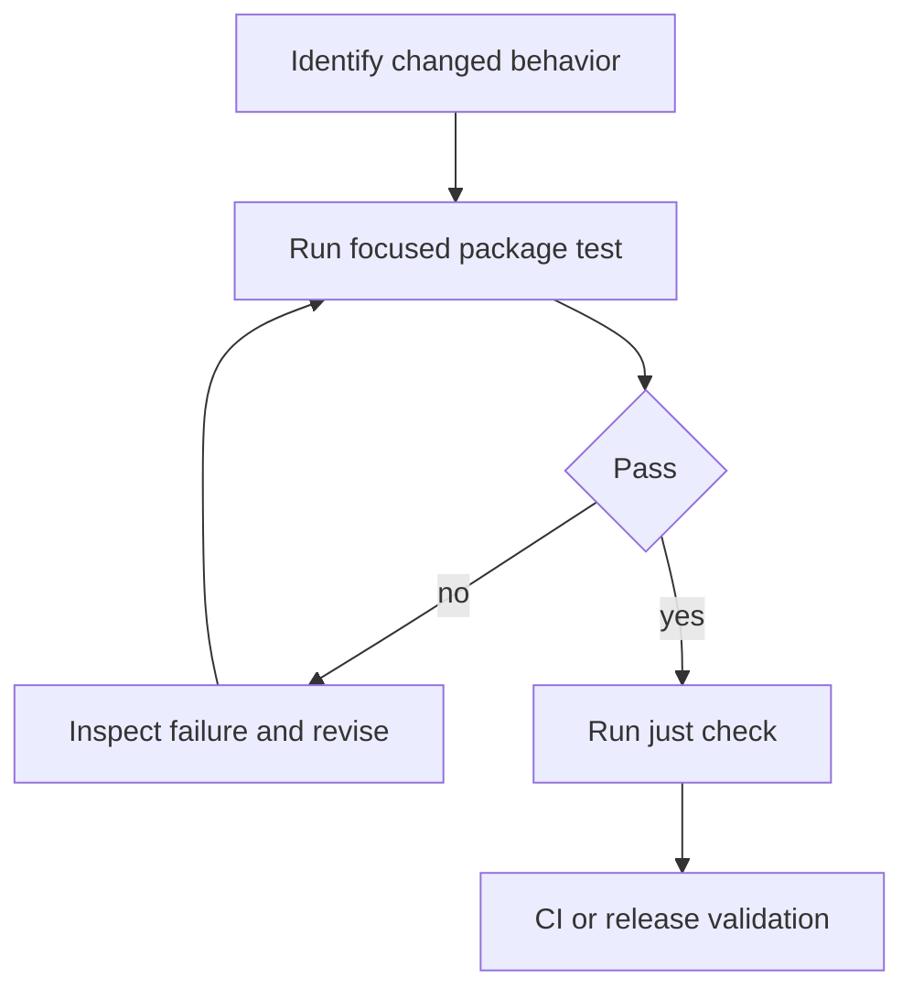
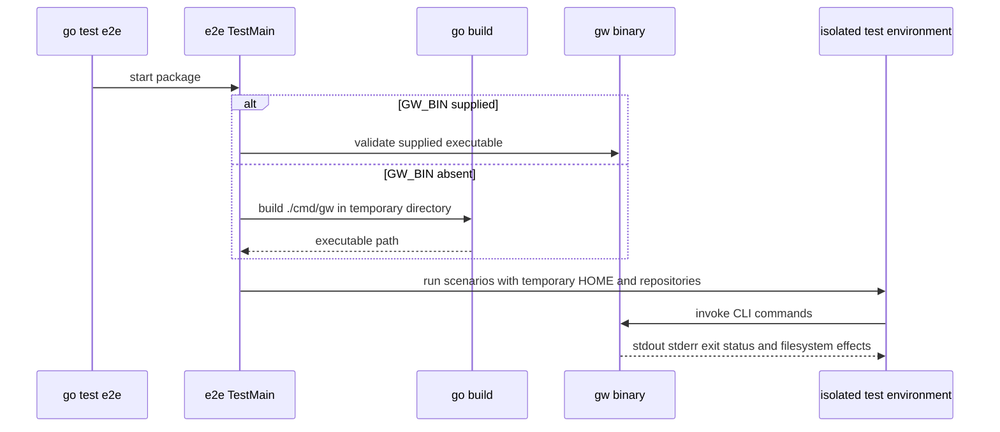

# Testing and Quality Gates

Grove has three complementary validation boundaries:

1. **Focused package tests** prove a local parser, state transition, Git wrapper, or workspace invariant quickly.
2. **`just check`** is the repository gate: unit tests, uncached compiled-binary e2e tests, and static quality checks.
3. **End-to-end tests** invoke the `gw` executable in isolated temporary environments and verify user-visible behavior across the filesystem, Git, state, and hooks.

Start with the narrowest boundary that owns the behavior, then run the full gate before pushing.



This flow shows the recommended progression from a fast local proof to the single repository quality gate used by automation.

## Commands and what they cover

Use these recipes from the repository root:

```sh
# One named unit test, with verbose output
go test ./internal/workspace -run TestName -v

# Unit tests for command and internal packages (optional extra args are forwarded)
just test
# Equivalent base command: go test ./cmd/... ./internal/...

# The complete repository gate
just check

# Build gw and run the compiled-binary suite without the Go test cache
just e2e

# Optional network-dependent clone coverage
GROVE_EXTERNAL_E2E=1 GW_BIN="$PWD/gw" go test ./e2e -count=1
```

Use the correctly cased environment variable in the last example: `GROVE_EXTERNAL_E2E=1`.

`just test` covers `./cmd/...` and `./internal/...`; e2e is intentionally separate. `just check` is defined as `test e2e vet fmt-check gocyclo staticcheck deadcode`, so it runs:

- unit tests;
- `just e2e`, which builds `gw` and runs `go test ./e2e -count=1` with `GW_BIN` set;
- `go vet ./...`;
- `fmt-check`, which fails when `gofmt -l .` lists a file (repair deliberately with `gofmt -w .`);
- `go tool gocyclo -over 20 .`;
- `go tool staticcheck ./...`; and
- `go tool deadcode ./...`, whose output is itself a failure even though the tool exits successfully.

The lint tools are pinned in the `tool` directive in `go.mod` and are invoked with `go tool`; update a tool with `go get -tool <pkg>@<version>`. The deadcode gate reports functions unreachable from `main`. Keep helpers used only by tests in `_test.go` files rather than production files, or they can fail this gate.

## Hooks, CI, and release validation

After `just dev`, the `.githooks/pre-commit` hook clears Git repository environment variables, sets `GIT_CEILING_DIRECTORIES=/`, and runs only the fast subset `just test vet fmt-check`. It does not run e2e, gocyclo, staticcheck, or deadcode; those remain part of `just check`.

CI's check job runs exactly `just check` after checking out the repository, selecting the Go version from `go.mod`, and installing `just`. Its separate install-script job runs only after that check succeeds. The release workflow uses the same `just check` gate before extracting release notes and invoking GoReleaser. Add new validation to the `Justfile` rather than duplicating it in either workflow.

## The e2e build and cache boundary

The e2e package tests the compiled binary, not internal Go services. `TestMain` uses `GW_BIN` when supplied; otherwise it runs `go build -o <temporary path> ./cmd/gw`, verifies that the resulting path exists and is executable, and then runs the tests. `just e2e` builds the repository's `gw` first and supplies its absolute path through `GW_BIN`.

This is a deliberate cache boundary. The Justfile keeps e2e separate because it shells out to `go build`; the Go test cache cannot infer all source changes behind that separately built binary. The recipe therefore runs `go test ./e2e -count=1`.

Each e2e environment gets an independent temporary `HOME`, repository directory, Grove state and workspace directories, Git identity, and command timeout. Required scenarios use local repositories and `file://` remotes, so the normal gate does not require network access. The public HTTPS clone check is skipped unless explicitly opted in:

```sh
GROVE_EXTERNAL_E2E=1 GW_BIN="$PWD/gw" go test ./e2e -count=1
```

`GROVE_EXTERNAL_E2E=1` enables only that network-dependent check. Set `GW_BIN` when testing a prebuilt executable; leave it unset when the e2e harness should build a temporary one. A focused e2e scenario can be run with `go test ./e2e -run TestPrune -count=1`.



This sequence shows why e2e validates the executable boundary and why `GW_BIN` controls whether the harness builds or reuses a binary.

## Focused tests by behavioral seam

### CLI parsing, prune selection, and output

`cmd/prune_test.go` is the narrow boundary for prune semantics. Keep parser and flag tests close to the command:

- `TestParseMinAge` covers hours (`12h`), days (`7d`), weeks (`2w`), zero, bare numbers interpreted as days, and rejection of empty, negative, malformed, or unsupported-unit values.
- `TestPruneCommandDefaults` protects the `7d` default and the false defaults for `--yes` and `--json`.
- Candidate tests protect the inclusive age boundary, computed `age_days`, state order, unparseable timestamps, and inclusion of a missing directory regardless of age.
- Preview tests protect JSON `[]` rather than `null`, the `missing` field, and serialization; deletion tests prove every candidate is attempted, failures are recorded on the candidate, and errors are joined rather than fail-fast.

The corresponding e2e tests (`TestPruneListsOldWorkspacesWithoutDeleting`, `TestPruneYesDeletesOldWorkspaces`, `TestPruneDefaultMinAgeKeepsRecentWorkspaces`, and stale-directory coverage) protect the observable contract: preview does not delete, `--yes` removes old workspaces and their source branches, recent workspaces remain, and a missing directory is still cleaned from state and Git registration.

### Workspace lifecycle and deletion safety

`internal/workspace` owns filesystem and Git mechanics. Its temporary test environment creates real local repositories only where worktree or branch behavior matters; injected functions are preferred for ordering and failure tests.

Deletion is a two-phase operation: preflight all repositories before mutation, then lock and reload state before moving an existing root to `.trash`, pruning Git worktree registrations, removing state, and cleaning eligible branches. Trash unlinking is best effort and can be asynchronous. If the root is already missing, it is treated as a stale record: forced deletion still cleans registrations, state, and eligible branches without quarantining a nonexistent root.

`remove_test.go` protects the important failure boundaries: dirty worktrees fail safely without `Force`, `Force` removes them, preflight does not partially mutate, prune or state-removal failures restore the root and preserve state when possible, branch-preservation and unmerged-branch policy are honored, stale records are cleaned, and trash unlinking has safe-path, spawn-fallback, ordering, and immediate-name-reuse coverage. Use the injected `PruneWorktree`, `RepairWorktree`, `RemoveState`, `StartUnlink`, and `UnlinkTrash` seams rather than sleeps or filesystem races.

Other focused workspace tests map to distinct seams: `create_test.go` covers rollback and multi-repository creation, `sync_test.go` covers rebase and dirty/conflict behavior, `reset_test.go` covers branch reset safety, `prune_branches_test.go` covers unused branch selection, and `doctor_test.go` covers stale worktrees and trash repair.

### State, Git, logging, and lifecycle hooks

`internal/state/state_test.go` uses `t.TempDir()` and a temporary `state.Store` to exercise load, add, update, rename, remove, JSON persistence, atomic writes, and process-level lock serialization. This keeps tests independent of `~/.grove` and makes concurrent-update behavior reproducible.

`internal/gitops` tests use local repositories to cover worktree and branch operations, remote and base-branch resolution, clone behavior, and Git error handling. `trace_test.go` specifically protects verbose command tracing, absence of debug traces when not verbose, credential redaction before truncation, bounded output, Git stderr preservation, and valid UTF-8 truncation. `internal/logging/logging_test.go` covers log-file creation in both modes, debug suppression, info and error levels, rotation, and closing the previous log file on reconfiguration.

Lifecycle behavior is best tested at two levels. Operations or workspace package tests inject fake stores, workspace services, and hook functions to prove ordering and abort-versus-warning policy without spawning a shell. The e2e lifecycle tests verify the user boundary: `post_create` and `pre_delete` run, source placeholders are populated, streaming metadata is visible, `on_failure = "abort"` blocks creation, and the default failure policy warns and continues. `--no-hooks` and `-n` must skip both lifecycle hooks.

## Change checklist

1. Identify the owning package and run its narrowest named test.
2. For CLI changes, cover accepted, rejected, default, boundary, and output cases.
3. For workspace changes, cover preflight ordering, dirty and force behavior, rollback, stale records, branch policy, and trash lifecycle.
4. For state or Git changes, use temporary repositories and stores; use injected failures for ordering and rollback.
5. For hooks, test lifecycle policy with injected dependencies and verify the observable path with e2e.
6. Run `just check` before pushing. Use `just e2e` or `go test ./e2e -run TestName -count=1` for focused executable scenarios.
7. Opt into `GROVE_EXTERNAL_E2E=1` only when network-dependent coverage is intentional.
8. For a release, update `CHANGELOG.md`, commit, and use `just release X.Y.Z`; the release workflow has already required the same `just check` gate before GoReleaser.
