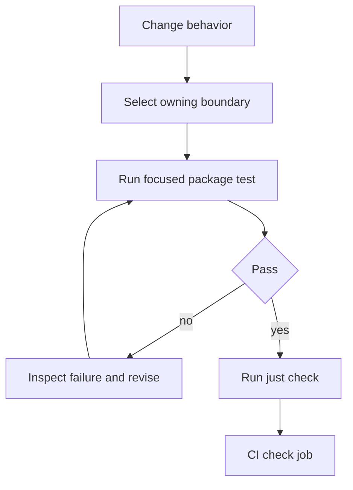

# Testing and Verification

Grove has three useful verification boundaries:

1. **Focused package tests** give fast feedback for a parser, output formatter, state transition, Git wrapper, workspace invariant, or hook policy.
2. **The executable e2e suite** runs `gw` in isolated temporary environments and checks the user-visible contract across filesystems, Git, persisted state, hooks, and exit status.
3. **`just check`** is the repository gate. It combines unit tests, uncached compiled-binary e2e tests, and static quality checks, and is the command CI invokes.

Start with the narrowest owner, then run the full gate before pushing.



This flow shows the recommended progression from a local proof to the single repository gate.

## Commands and quality gates

Run these from the repository root:

```sh
go test ./internal/operations -run TestResolveBranchThenCreateResolvesOnce -v
just test
just e2e
just check
# Optional network-dependent coverage:
GROVE_EXTERNAL_E2E=1 GW_BIN="$PWD/gw" go test ./e2e -count=1
```

`just test` runs `go test ./cmd/... ./internal/...`; e2e is deliberately separate because `just e2e` first builds `gw` and then runs `go test ./e2e -count=1` with `GW_BIN` set. The `-count=1` boundary prevents Go's test cache from hiding source changes that affect the separately built binary.

`just check` is the single source of truth in `Justfile`: `test e2e vet fmt-check gocyclo staticcheck deadcode`. It therefore runs unit and package tests, the compiled-binary e2e suite, `go vet ./...`, a `gofmt -l .` failure check, `go tool gocyclo -over 20 .`, `go tool staticcheck ./...`, and `go tool deadcode ./...`. The deadcode recipe fails on any output because the tool itself exits successfully. Tools are pinned in `go.mod` and invoked with `go tool`.

CI checks out the repository, selects Go from `go.mod`, installs `just`, and runs exactly `just check`; its install-script job waits for that check. Keep new repository validation in `Justfile`, not duplicated in `.github/workflows/ci.yml`. The pre-commit hook is intentionally faster (`just test vet fmt-check`) and does not replace the full gate.

## E2E boundary and isolation

The e2e harness uses `GW_BIN` when supplied. Otherwise `e2e/TestMain` builds `./cmd/gw` into a temporary path and verifies it is executable. Each environment gets its own temporary `HOME`, `.grove` state, workspace directory, repositories, Git identity, and command timeout. Normal scenarios use local repositories and `file://` remotes, so network access is not required; the public HTTPS clone check is enabled only with `GROVE_EXTERNAL_E2E=1`.

Use `go test ./e2e -run TestName -count=1` for a focused executable scenario. Inspect both stdout and stderr when testing CLI behavior: structured and path-oriented results must remain clean on stdout, while diagnostics, hook stream output, and warnings belong on stderr. `cmd/query_output_test.go` asserts exact line, TSV, JSON-lines, and path output; `cmd/prune_test.go` also protects JSON `[]` rather than `null` and candidate serialization.

## Test by ownership boundary

### Commands and output

`cmd/*_test.go` owns command-local parsing, defaults, flag interactions, and serialization. For a CLI change, cover accepted and rejected inputs, defaults, boundary values, failure exit behavior, and output streams. Prune tests are a model: they cover duration syntax and invalid units, inclusive age selection, stale or missing directories, preview versus `--yes`, joined deletion errors, and JSON fields. E2E prune scenarios then verify that old workspaces and source branches are actually removed while preview and recent workspaces are not.

### Operations and lifecycle policy

`internal/operations` is the orchestration boundary; `internal/workspace` remains lifecycle-free. `internal/operations/service_test.go` uses fakes and an order trace to prove that `resolve_branch` precedes creation, `post_create` follows a successful creation, `pre_delete` precedes deletion, and `post_add_repo` follows actual additions. It also tests the important once-only and safety rules:

- `resolve_branch` runs once per create request. Calling `ResolveBranch` before `Create` marks the request resolved, so `Create` reuses the branch rather than invoking the hook again.
- `--track` bypasses the resolver and preserves the explicitly selected existing branch.
- Resolver failures and invalid branch output become an aborting `HookError` before workspace creation. The command resolves before a destructive `--replace` deletion, so a failed resolver leaves the old workspace intact; e2e covers this invariant.
- `post_add_repo` is suppressed when the workspace service reports that zero repositories were added, including a repeated add; no-op additions must not emit progress or lifecycle side effects.

Test these policies with injected dependencies rather than shelling out. Then use `e2e/lifecycle_test.go` for the executable contract: source placeholders are populated, hooks run in the correct phases, streamed output is visible, `on_failure = "abort"` blocks creation, default hook failure warns and continues, and `--no-hooks` or `-n` skips lifecycle hooks.

### Hook mechanics

`internal/lifecycle/lifecycle_test.go` protects the mechanism beneath the operation policy. Placeholder expansion shell-quotes values, supports `{name}`, `{path}`, `{branch}`, `{source_url}`, `{source_ref}`, and `{source_title}`, and expands absent source values to empty strings. Resolver output is trimmed to one line; empty, blank, multiline, non-zero, and timed-out results fail and always abort. Resolver stderr is excluded from the returned branch, but failure stderr is echoed with the hook name.

For ordinary hooks, test the three output modes: a successful non-streaming hook is silent, `stream = true` sends prefixed lines live to stderr, and a failing non-streaming hook echoes captured output. Test timeout behavior, including killing child processes, and verify malformed timeout configuration fails open with a warning rather than silently preventing the hook. The e2e tests should confirm the same behavior through the binary.

### Workspace, state, and Git invariants

`internal/workspace` tests use real temporary repositories where worktree and branch behavior matters, and injected failures where ordering is the subject. Creation and `AddRepos` tests assert atomic safety: a failed multi-repository operation removes only worktrees and branches created by that invocation, leaves pre-existing roots, branches, and occupied paths untouched, and does not persist a partial workspace. Concurrent creation tests verify both state entries survive locking.

Deletion and synchronization tests should cover dirty-worktree refusal without force, force behavior, preflight before mutation, rollback after Git or state failure, stale worktree cleanup, branch preservation and unmerged-branch policy, and `.trash` lifecycle. These are safety assertions, not mere implementation details: inspect filesystem state, Git worktree registration, branch existence, and persisted state after every injected failure. `internal/gitops/gitops_test.go` supplies the lower-level checks for branch, worktree, remote, clone, and Git error behavior; use local repositories rather than network fixtures.

`internal/state/state_test.go` validates load, add, update, rename, remove, JSON persistence, atomic file replacement, and process-level lock serialization in a temporary store. Changes to state writes should retain the invariant that readers see a complete old or new state, never a partial JSON file.

### Logging and Git trace

`internal/logging/logging_test.go` verifies log creation both with and without verbose mode, debug suppression when not verbose, info and error levels, rotation after the size limit, and closing the previous file when `Setup` is reconfigured. Any logging change should assert both content and file lifecycle, including rotation rather than only checking that a message was emitted.

`internal/gitops/trace_test.go` verifies that verbose Git traces include command, directory, success or Git stderr, and omit raw `exit status` noise; non-verbose runs emit no debug trace. It also asserts credentials are redacted in command arguments and stderr **before** truncation, long traces receive a truncation marker and bounded size, and truncation preserves valid UTF-8. Never add a trace test that places secrets in an unredacted fixture or relies on network behavior.

## Maintainer checklist

1. Identify the owner: `cmd`, `internal/operations` or `lifecycle`, `internal/workspace` or `state`, `internal/gitops`, logging, or e2e.
2. Run the narrowest named test, including negative and boundary cases.
3. For lifecycle changes, assert ordering, once-only behavior, `--track` bypass, resolver validation, source placeholders, output/failure policy, and no-op suppression.
4. For workspace or state changes, assert atomicity, rollback, branch/worktree cleanup, locking, and preservation of pre-existing resources.
5. For CLI or logging changes, assert stdout cleanliness, stderr diagnostics, JSON shape, rotation, and trace redaction/truncation.
6. Run `just check`; use `just e2e` or a focused uncached e2e command while iterating.
7. Opt into `GROVE_EXTERNAL_E2E=1` only when network-dependent coverage is intentional.
