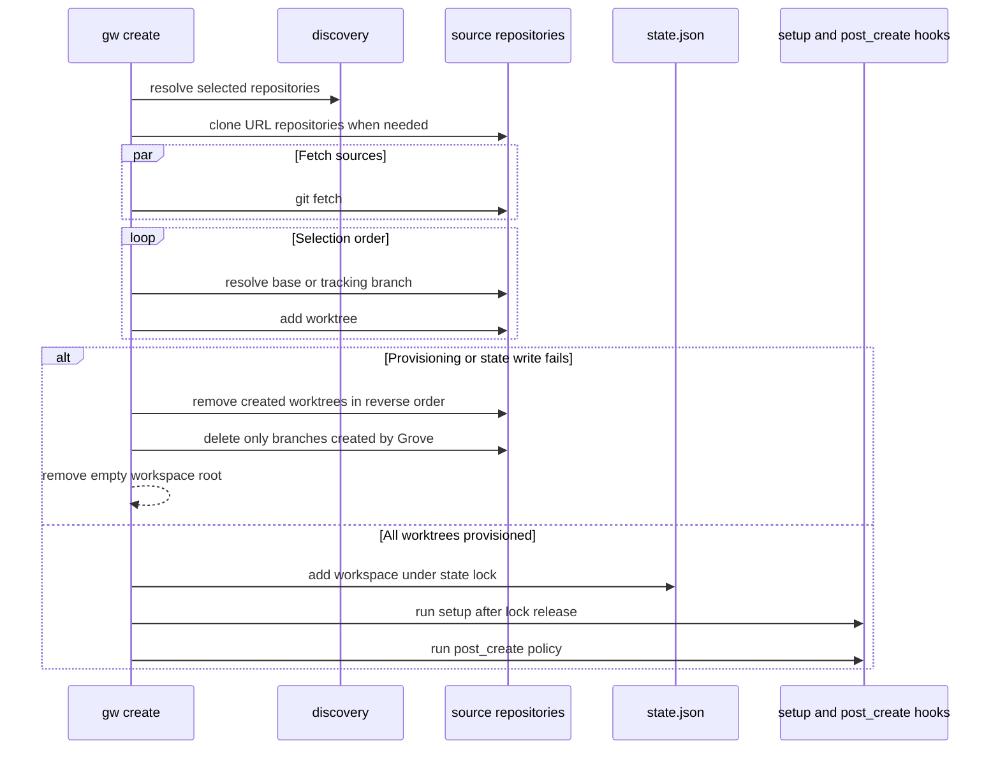

# Workflows

Grove combines persisted workspace metadata with one Git worktree per selected repository. The CLI discovers source repositories from configured directories, while workspace services own Git and state mutations. The operation service adds global lifecycle-hook policy around those primitives.

## Initialize and discover

```bash
gw init ~/dev ~/work/microservices
```

`gw init` writes configuration for the supplied repository directories and immediately scans them with the discovery cache. Later commands rediscover repositories from those configured directories and de-duplicate them by name. A create or add operation can also accept a Git URL: Grove clones it into the first configured `repo_dir`, then rejects a name collision if that name already maps to another local path (`cmd/init_cmd.go#L10-L26`, `cmd/create.go#L55-L80`, `cmd/addrepo.go#L32-L57`).

## Create: provision, persist, then hook

Typical non-interactive creation is:

```bash
gw create my-feature --branch feat/login --repos svc-auth,svc-api
gw create pr-42 --branch feat/login --repos svc-auth --track \
  --source-url "https://github.com/org/repo/pull/42" --source-provider github \
  --source-ref 42 --source-title "Add login flow"
```

Without repository flags, create offers configured presets and otherwise prompts for a multi-selection. Repository names are validated before provisioning. `--track` applies to all selected repositories unless the resolver identifies one `TrackBranchRepo`; it checks out an existing remote branch when available and otherwise falls back to creating a fresh branch from the base. Source fields are opaque provenance persisted on the workspace and expanded only into hook placeholders (`cmd/create.go#L81-L150`, `internal/workspace/create.go#L29-L53`, `internal/lifecycle/lifecycle.go#L27-L38`).

Creation has two phases. It fetches selected source repositories concurrently, treating fetch failure as a warning and continuing with local refs. It then creates worktrees sequentially so a later failure can roll back safely. Base resolution falls back to `HEAD`; branch creation retries with the `origin/` prefix removed and then `HEAD`. A branch already used by a worktree is rejected (`internal/workspace/create.go#L126-L165`, `internal/workspace/create.go#L178-L256`).



*Create separates parallel fetch, ordered provisioning, rollback, locked persistence, and post-commit hooks.*

The workspace is added to state only after all worktrees exist. Setup commands from each source repository’s `.grove.toml` run concurrently after the lock is released; failures are warnings and do not undo the committed workspace. The operation-level `post_create` hook runs after creation too: warning-policy failures are reported, while `on_failure = "abort"` makes the command fail without rolling back the persisted workspace (`internal/workspace/create.go#L55-L84`, `internal/workspace/create.go#L259-L310`, `internal/operations/service.go#L73-L91`).

## Hooks and lock boundaries

Lifecycle hooks are configured globally and executed through `sh -c`. They support `{name}`, `{path}`, `{branch}`, `{source_url}`, `{source_ref}`, and `{source_title}`. Hooks may stream prefixed output to stderr or capture output until failure; a positive timeout kills the hook process group. A non-zero hook is warning-only unless its metadata sets `on_failure = "abort"`. `--no-hooks` and `-n` disable lifecycle hooks (`internal/lifecycle/lifecycle.go#L21-L38`, `internal/lifecycle/lifecycle.go#L62-L124`, `cmd/root.go#L63-L68`).

`pre_delete` is evaluated before destructive mutation. An aborting hook prevents deletion; a warning-policy failure allows it to continue. Repository-local `setup`, `teardown`, `pre_sync`, and `post_sync` commands come from `.grove.toml`; setup and teardown run outside the state lock because user commands may invoke `gw` (`internal/operations/service.go#L106-L126`, `internal/workspace/remove.go#L239-L246`, `internal/workspace/sync.go#L48-L62`).

## Status, sync, reset, and navigation

```bash
gw status [NAME]
gw status NAME --json --pr
gw sync [NAME]
gw reset [NAME]
gw reset [NAME] --discard
gw go NAME
gw go --back
```

`status` resolves a workspace by name or current directory, collects each repository’s live branch, porcelain status, and ahead/behind counts concurrently, and optionally adds PR information. Output formatting does not change collection (`internal/workspace/status.go#L27-L66`, `internal/workspace/status.go#L78-L124`).

`sync` operates on repositories independently and concurrently. It fetches, skips dirty worktrees, resolves the base branch, and rebases only when the workspace branch is behind. A failed rebase is aborted for that repository; other repositories continue. Repository-local `pre_sync` and `post_sync` surround a successful rebase (`internal/workspace/sync.go#L13-L63`). `reset` first compares the live branch with the branch recorded in state. It switches clean worktrees, treats detached `HEAD` as different, skips dirty worktrees by default, and permits discard of tracked changes only with `--discard`; each repository then follows the same sync path (`internal/workspace/reset.go#L13-L74`).

`gw go` prints a workspace path so shell integration can change the caller’s directory. `--back` returns the unique source-repository parent or prompts when parents differ. `shell-init` consumes the path separately, and `GROVE_CD_FILE` lets create communicate the new path without taking over normal command output (`cmd/go_cmd.go#L27-L144`, `cmd/go_cmd.go#L202-L211`, `cmd/shellinit.go#L36-L64`, `internal/workspace/create.go#L77-L84`).

## Add and remove repositories

```bash
gw add-repo [NAME] --repos svc-worker
gw remove-repo [NAME] --repos svc-worker
gw remove-repo [NAME] --repos svc-worker --force
```

`add-repo` resolves the workspace from its argument or current directory, discovers or clones sources, and sequentially provisions worktrees on the workspace’s recorded branch. It updates state only after all selected additions succeed; a failure rolls back worktrees and branches created by that attempt. Setup runs after the state lock is released (`cmd/addrepo.go#L27-L80`, `internal/workspace/repos.go#L12-L89`).

`remove-repo` prompts unless `--force` is supplied. Safe preflight checks the expected registration, branch, current checkout, and clean status. Under the lock, each successful removal immediately removes its worktree, deletes its non-preserved branch, and updates the in-memory workspace; failures are accumulated while successful removals remain, so multi-repository removal is intentionally partial rather than transactional (`cmd/removerepo.go#L27-L63`, `internal/workspace/repos.go#L92-L166`, `internal/workspace/remove.go#L261-L311`).

## Destructive cleanup: delete and quarantine

```bash
gw delete NAME
gw prune                         # preview, default minimum age 7d
gw prune --min-age 12h
gw prune --min-age 2w --yes
gw prune --yes --json
gw prune branches --gone --fetch --yes
```

The top-level delete command invokes the operation service with forced workspace cleanup after interactive or pipeline selection. The operation service runs `pre_delete`, records the expected creation timestamp and path, and passes those expectations into the locked workspace deletion so a concurrent state/path change is rejected (`cmd/delete.go#L41-L75`, `internal/operations/service.go#L106-L125`).

```mermaid
sequenceDiagram
    participant CLI as gw delete or prune
    participant Hook as pre_delete
    participant State as state lock and state.json
    participant FS as workspace filesystem
    participant Git as source repositories
    participant Trash as unlink worker
    CLI->>Hook: run policy unless hooks disabled
    alt Hook aborts
        Hook-->>CLI: stop before mutation
    else Hook allows
        CLI->>State: reload and verify expected path and timestamp
        alt Root exists
            CLI->>FS: rename root into .trash
        else Root is missing
            CLI-->>FS: skip quarantine
        end
        loop Each source repository
            CLI->>Git: git worktree prune
        end
        alt Prune or state removal fails
            alt Root was quarantined
                CLI->>FS: restore root
                CLI->>Git: repair worktree registration
            else Root was already missing
                CLI-->>FS: leave root absent
            end
        else Registrations and state cleanup succeed
            CLI->>State: remove workspace record
            loop Each workspace branch
                CLI->>Git: delete branch unless preserved
            end
            opt Root was quarantined
                CLI-->>Trash: unlink quarantined bytes
            end
        end
    end
```

Deletion is a two-phase quarantine operation. For an existing root, Grove renames it into a sibling `.trash/<name>-<timestamp>`, freeing the live path before pruning each source repository’s Git worktree registration. If Git pruning or state removal fails, the quarantined root is restored and registrations are repaired where possible. Once registrations are pruned, state is removed; branch deletion follows and failures are warnings. Unlinking quarantined bytes is asynchronous when configured, with a synchronous best-effort fallback; the unlink guard accepts only a direct child of `.trash` (`internal/workspace/remove.go#L82-L140`, `internal/workspace/remove.go#L143-L229`).



*Delete shows hook gating, quarantine, Git registration cleanup, rollback, state removal, branch cleanup, and deferred unlinking.*

If the root is already missing, Grove treats the record as stale: it skips quarantine and restoration but still prunes registrations, removes state, and attempts branch cleanup. This is why prune can repair out-of-band directory removal (`internal/workspace/remove.go#L97-L140`, `e2e/prune_test.go#L105-L137`).

## Age-based workspace prune

Without `--yes`, `prune` only previews. `--min-age` accepts `h`, `d`, or `w`; a bare number means days and the default is `7d`. Negative values and unknown units are rejected. A candidate is either a present workspace with a parseable `created_at` at least that old, or any workspace whose directory is missing. Invalid timestamps do not make a present workspace age-eligible; age is creation time, not last navigation (`cmd/prune.go#L26-L40`, `cmd/prune.go#L57-L110`, `internal/workspace/prune.go#L5-L16`).

Table output contains `Name`, `Branch`, `Created`, `Age`, and `Note`; missing directories are marked `directory missing`. JSON emits candidate records with `name`, `branch`, `created_at`, `age_days`, and `missing`; after `--yes`, failed records also contain `error`. With `--yes`, every candidate is sent through forced `operations.Service.Delete`, failures are recorded per workspace, later candidates are still attempted, and the command returns a joined non-zero error if any deletion failed (`cmd/prune.go#L116-L203`, `e2e/prune_test.go#L21-L137`).

## Branch prune

`gw prune branches` inspects every uniquely discovered main clone concurrently. It selects local branches merged into the resolved base branch, excluding `HEAD`, the base branch, branches checked out in any worktree, and branches referenced by any Grove workspace. `--gone` additionally selects branches whose upstream was deleted; those may contain unmerged commits and are force-deleted. `--fetch` runs `git fetch --prune` before inspection. Candidate and repository errors are sorted and reported independently (`cmd/prune_branches.go#L52-L85`, `internal/workspace/prune_branches.go#L41-L83`, `internal/workspace/prune_branches.go#L86-L137`).

Branch prune is preview-only by default. `--yes` attempts each candidate independently, uses safe deletion for merged branches and forced deletion for gone branches, prints successful candidates, and returns joined failures without stopping later deletions (`internal/workspace/prune_branches.go#L133-L137`, `cmd/prune_branches.go#L70-L85`).

## Machine-readable pipelines

List and status commands support `table`, `json`, `jsonl`, `tsv`, `name`, and `path` output; `--json` remains a compatibility alias. Query data belongs on stdout while progress, prompts, warnings, and errors belong on stderr. This makes pipelines such as these safe:

```bash
gw list -o name | fzf
gw status my-feature -o jsonl | jq -r 'select(.changed > 0) | .repo'
gw list -o name | grep '^old-' | gw delete --stdin --yes
```

`gw go` intentionally emits only the destination path on stdout. The shell wrapper changes the caller’s directory and preserves command status; create uses `GROVE_CD_FILE` for the same separation (`README.md#L105-L128`, `cmd/go_cmd.go#L202-L211`, `cmd/shellinit.go#L36-L64`).

## Extension boundary and focused tests

Unknown commands are delegated to standalone `gw-<name>` executables searched in `~/.grove/plugins/` and then `$PATH`. Grove supplies `GROVE_DIR`, `GROVE_CONFIG`, `GROVE_STATE`, and `GROVE_WORKSPACE` when available; plugins should use Grove commands for mutations rather than editing state (`cmd/root.go#L101-L121`, `docs/plugins.md#L1-L3`, `docs/plugins.md#L52-L67`).

Focused coverage exercises source placeholders, hook warning versus abort policy, `--no-hooks`, create rollback, prune age syntax and preview, stale-directory cleanup, two-phase delete restoration, and destructive prune state/registration/branch removal (`e2e/lifecycle_test.go#L10-L96`, `cmd/prune_test.go#L21-L120`, `e2e/prune_test.go#L21-L137`, `internal/workspace/remove_test.go#L162-L338`).

## Safe modification invariants

- Validate repository selections and expected workspace identity before mutation.
- Hold the state lock for persisted mutations; run user-owned setup and teardown outside it.
- Preserve per-repository independence for status, sync, reset, and prune reporting.
- Keep dirty-worktree protection as the default; make intentional loss explicit with `--discard` or `--force`.
- Roll back only resources created by a failed create/add attempt.
- Restore a quarantined root when logical deletion cannot complete; a missing root has nothing to restore but still requires Git and state cleanup.
